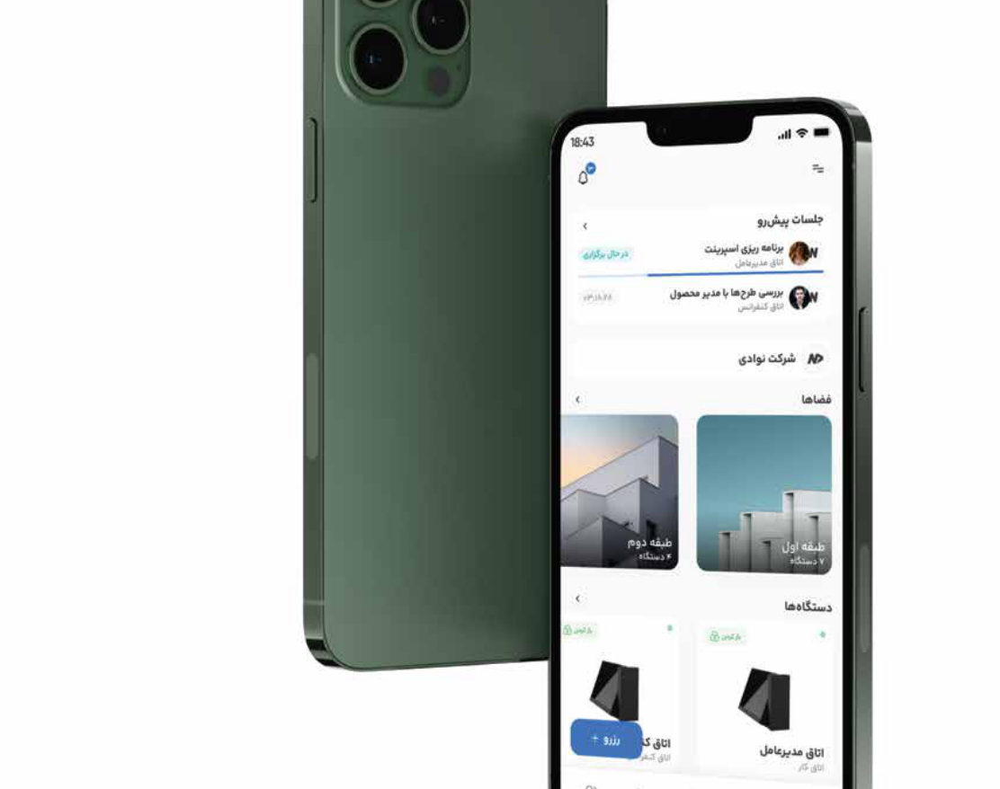
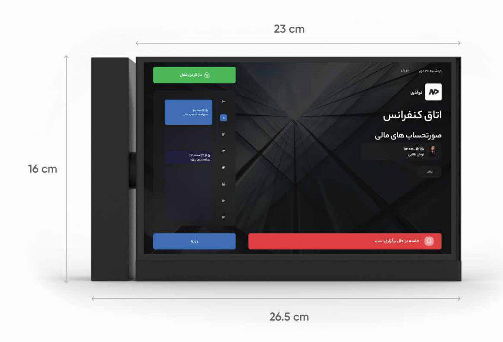
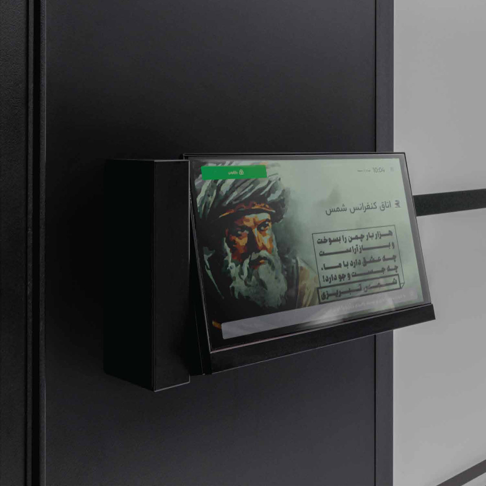
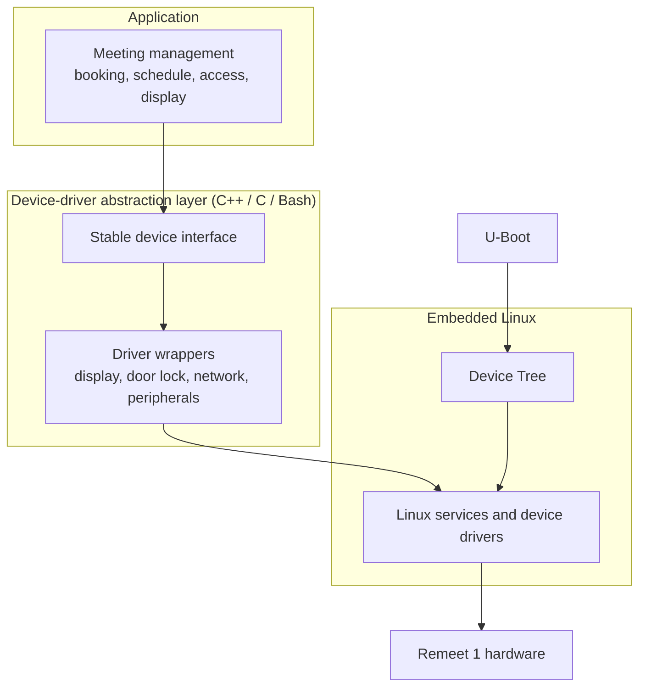

<h1 align="center">Remeet 1</h1>
<h3 align="center">Smart meeting room display and door access panel, with a device-driver layer on embedded Linux</h3>

<p align="center">
  
</p>

> **Remeet 1** is a wall- and door-mounted meeting room device that shows room status and schedule, unlocks the door, and is managed from mobile and web apps. As **Senior Embedded Systems (IoT) Engineer** at Novaday Co. (10/2022 – 07/2026), I owned the device from PCB design through embedded software, and I built the device-driver abstraction layer that connects application code to the Linux hardware stack.

---

## Table of Contents

- [My Role](#my-role)
- [Product at a Glance](#product-at-a-glance)
- [Key Features](#key-features)
- [Hardware](#hardware)
- [Device Software Architecture](#device-software-architecture)
- [Deployment](#deployment)
- [Repository Contents](#repository-contents)
- [Note on Confidentiality](#note-on-confidentiality)
- [Contact](#contact)

---

## My Role

**Senior Embedded Systems (IoT) Engineer**, Novaday Co. · 10/2022 – 07/2026

I was responsible for Remeet 1 across hardware and software: from the PCB and device design, through the embedded firmware and Linux platform, to the meeting-management application layer.

| Area | What I did |
|------|------------|
| **Hardware** | Designed the Remeet 1 PCB and the device's electronics for its 10.1-inch display, wall/door mounting, and concealed-wiring enclosure |
| **Platform customization** | Customized the Remeet1 product platform for meeting management: room booking, schedules, access control, and room information on the device |
| **Device-driver layer** | Created a **C++ / C / Bash device-driver abstraction layer** that bridges application developers with low-level Linux services, **Device Tree**, and **U-Boot** |
| **Software** | Wrote the device software in C/C++ on embedded Linux, covering the platform layer, boot configuration, and application features |

**Skills:** `PCB design` · `Embedded Linux` · `Device Tree` · `U-Boot` · `C++ / C` · `Bash` · `Device-driver abstraction` · `IoT connectivity` · `Meeting-management platform`

---

## Product at a Glance

Remeet 1 turns any meeting room into a managed space. The device sits beside the door and shows who is using the room now and what is coming next. People book rooms from a mobile app or the web, and the same system unlocks the door, so no keys or phone calls are needed to coordinate a meeting.

<p align="center">
  
</p>

---

## Key Features

**Meetings and rooms**
- Reserve meetings from the device, the mobile app, or the web app
- Meeting types: confidential, recurring, one-on-one, and group
- Room capacity limits, with a warning when the attendee count is exceeded
- Attendee lists and guest invitations with attendance tracking
- Personal, room, and colleague calendars, with meeting reminders and in-meeting chat

**Access control**
- Unlock the door remotely from the app or web
- Per-user access levels set by the organization
- QR-code unlocking, with movement logged per participant
- Per-device passwords, so the door can be opened from the device keypad even without the software

**Display and branding**
- Shows the company logo, room name, date, time, and current meeting
- Custom messages for welcome greetings, reminders, or meeting information
- Solar and Gregorian calendars, and time-zone aware scheduling

**Platform**
- Manage multiple companies, branches, or business units in one environment
- Android, iOS, and web applications
- Six languages: Persian, English, German, Arabic, Turkish, and French
- Cloud or on-premise server, depending on the organization's needs

---

## Hardware

Custom PCB designed in-house for the device's electronics. The table below lists the physical and product-level specifications.

| Parameter | Value |
|-----------|-------|
| Display | 10.1-inch |
| Dimensions | 26.5 × 16 × 7 cm |
| Enclosure | High-quality aluminum |
| Colors | Black, silver, white, or custom |
| Viewing angle | Adjustable up to 30° |
| Wiring | Concealed |
| Connectivity | Wi-Fi or LAN |
| Power | Mains supply at the installation site |
| Mounting | Wall or partition |

<p align="center">
  
</p>

<p align="center">
  
</p>

---

## Device Software Architecture

Application code does not talk to the hardware directly. The driver abstraction layer sits between the meeting-management application and the Linux kernel. Application developers call a stable interface, and the layer handles the Linux services, Device Tree bindings, and boot-time configuration underneath.



| Layer | Technology | Role |
|-------|------------|------|
| Application | C++ | Meeting management and device features |
| Abstraction layer | C++, C | Hides low-level device access behind one interface |
| Scripting | Bash | Build and system-level helper scripts |
| Linux | Device Tree, kernel drivers | Hardware description and device access |
| Boot | U-Boot | Bootloader and boot-time device setup |

---

## Deployment

- **Installation:** The product team handles installation, delivery, and training.
- **Network:** Wi-Fi or LAN connection to the internet (cloud) or to the organization's own network (on-premise).
- **Server:** Cloud, or a dedicated server inside the organization.
- **Support:** Online, phone, and ticketing.

---

## Repository Contents

```text
.
├── README.md
├── LICENSE
└── docs/
    ├── Remeet-Product-Brochure.pdf   # Product brochure
    └── images/
        ├── Remeet-1-Right-Black.png  # Product render
        ├── remeet-1-dimensions.jpg   # Dimensions
        ├── remeet-1-installed-door.jpg
        └── remeet-mobile-app.jpg
```

---

## Note on Confidentiality

This repository is a **portfolio description** of my work on Remeet 1. I **cannot publish the schematics or the source code** because of copyright. Both belong to **Novaday Co. (شرکت نوادی)**, the company that owns the Remeet product, and all rights are reserved.

The public materials in this repository (README, brochure, and images) are the only parts shared here. To order a device or request a consultation, use the official product page:

- Order and product preview: <https://remeet.ir/pages/preview.html>
- Product documentation: <https://docs.remeet.ir>

---

## Contact

**Pourya Afshintabar**, Senior Embedded Systems (IoT) Engineer · Vienna, Austria

- GitHub: [PATEmbedded](https://github.com/PATEmbedded)
- LinkedIn: [pourya-afshintabar](https://www.linkedin.com/in/pourya-afshintabar/)
